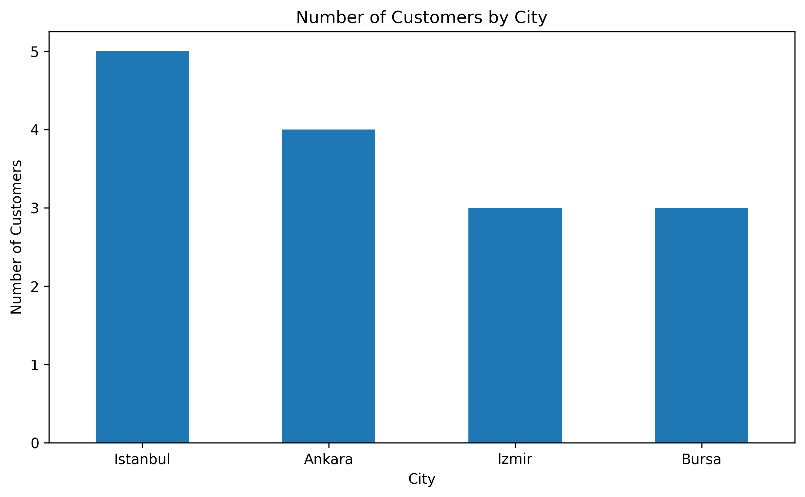
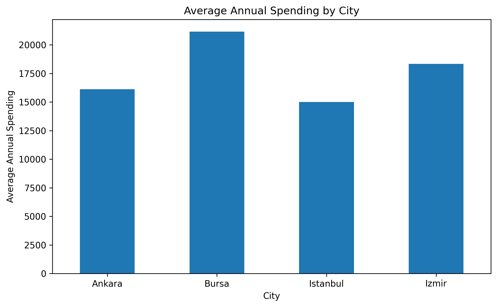
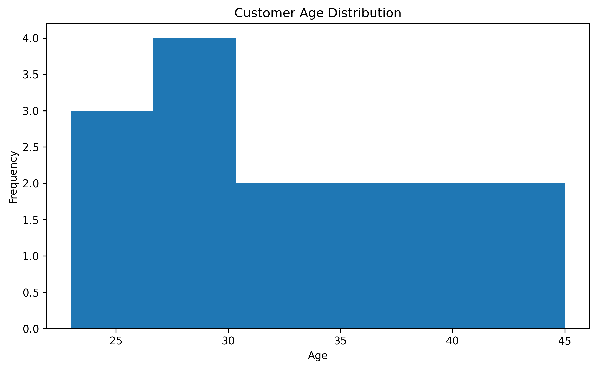

# Customer Data Analysis

A customer data analysis project developed using Python, Pandas, and Matplotlib.

## Project Overview

This project explores a sample customer dataset to identify demographic patterns and understand annual spending behavior.

## Dataset

The dataset contains 15 sample customers and includes:

- Customer ID
- Age
- Gender
- City
- Annual Spending

All customer records are synthetic and created for educational purposes.

## Technologies

- Python 3
- Pandas
- Matplotlib
- Google Colab

## Analysis

- Customer distribution by gender
- Customer distribution by city
- Average age by gender
- Average annual spending by city
- Customer age distribution

## Visualizations

### Customer Count by City

### Average Annual Spending by City

### Customer Age Distribution

## Learning Objectives

- Explore and summarize datasets using Pandas
- Group and analyze customer data
- Calculate averages and frequency distributions
- Create charts using Matplotlib
- Communicate findings through data visualization

## Project Status

Completed initial customer data analysis and visualization exercises.
